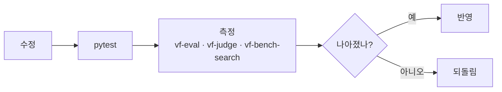

# 개발 규칙

## 명령

```bash
uv sync                      # 의존성
uv run pytest                # 단위 테스트 (느린 integration 제외)
uv run vf-server             # 서버 재시작 후 브라우저 새로고침으로 확인
```

## 변경 절차



- 효과는 숫자로 확인한다. 사람 표시(`eval/feedback.jsonl`)나 AI 채점에서 나아지지 않으면 반영하지 않는다.
- 한 검색어에만 맞춘 기준값은 다른 검색어를 망친다. 전체 표시로 다시 잰다.
- 가볍게 유지한다. 정확도를 올리더라도 검색 속도·메모리를 늘리는 변경은 피한다.
  (AI 채점은 결과 1개에 약 6초가 걸려 오프라인 검증에만 쓴다.)

## 영상 내용

- 디버깅할 때 썸네일·프레임 이미지, 자막, 검색 결과 본문은 보지 않는다.
- 출력은 시각·점수·개수·상태 코드만 남긴다.
- 영상과 대사는 외부 서비스로 보내지 않는다.
- 얼굴 인식은 로컬 실험 전용이다. 서비스화하려면 생체정보 법무 검토가 필요하다.

## 코드

- 목·스텁 금지. 테스트는 실제 동작하는 코드로만 작성한다.
- TypeScript: strict, `any` 금지. 타입·상수·유틸은 파일을 나누고 `index.ts`로 re-export하지 않는다.
- 모델은 `configs/models.lock.json`에 버전을 고정한다 (`uv run python -m videofinder.cli.lock_models`).

## git

- 원격 저장소: `git@github.com-personal:sojung9801/vector_search.git` (개인 SSH 키 별칭)
- 커밋 작성자는 개인 계정. 커밋 메시지에 Claude 표기를 넣지 않는다.
- git에서 제외: `test_videos/`, `vendor/`, `eval/reference/`, `eval/feedback.jsonl`
