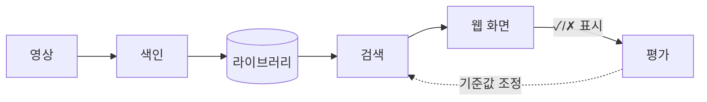
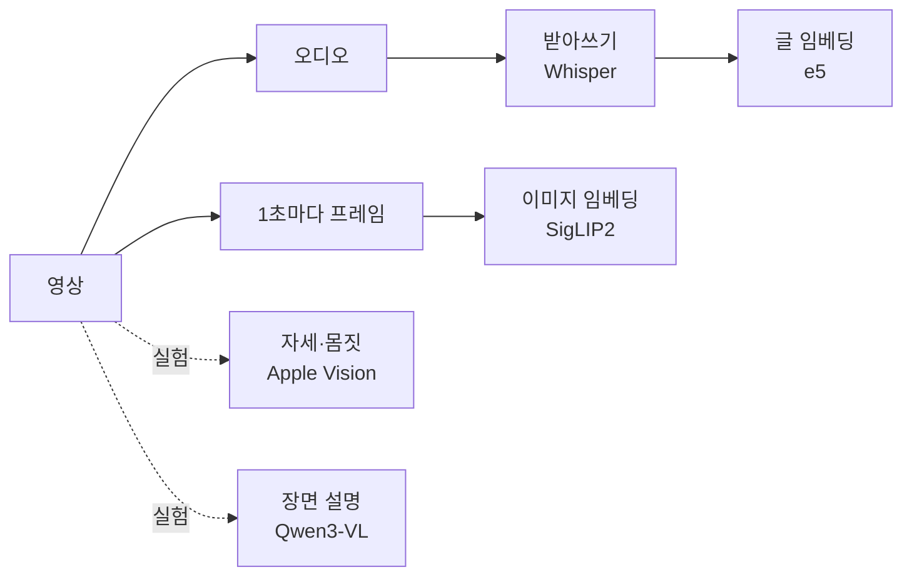
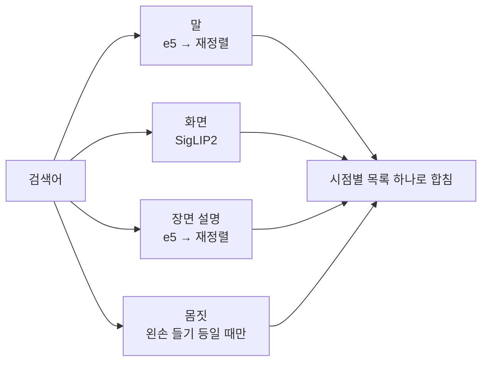

# 영상찾기

영상 한 개를 내 컴퓨터에서 분석해 **말·화면·몸짓**으로 원하는 시점을 찾는다.
모델은 전부 로컬에서 돌고, 영상은 밖으로 나가지 않는다.

## 시작하기

macOS + Apple Silicon, Python 3.12, [uv](https://docs.astral.sh/uv/) 필요.

```bash
uv sync

# ffmpeg 준비 (최초 1회)
uv run static_ffmpeg_paths
mkdir -p vendor/ffmpeg
cp .venv/lib/python3.12/site-packages/static_ffmpeg/bin/darwin_arm64/ff* vendor/ffmpeg/

uv run vf-models          # 모델 설치
uv run vf-index 영상.mp4   # 색인
uv run vf-server          # http://localhost:8787
```

## 동작 방식



### 색인



결과는 `~/Library/Application Support/com.local.videofinder/library/videos/<영상 해시>/`에 저장된다.

### 검색



- 검색어가 `~장면`, `~모습`으로 끝나면 화면 결과를 앞에 놓는다.
- 2글자 이하 검색어는 자막에 그대로 있는 곳만 찾는다.
- 결과는 썸네일·시각 카드 그리드로 보여주고, 자막이 있으면 카드 아래에 쓴다. 5초 이내의 결과는 카드 하나로 묶고, 자신 없는 결과는 접어 둔다.

## 한계

- 한 번에 영상 한 개만 검색한다.
- 몸짓·얼굴·장면 설명은 실험 기능이다. 왼손·오른손은 사람이 정면일 때만 잘 맞는다.
- 정답 장면이 없는 검색어에도 비슷한 결과를 보여 준다.

## 폴더

| 폴더 | 역할 |
|---|---|
| `src/videofinder/pipeline/` | 색인 |
| `src/videofinder/retrieval/` | 검색 |
| `src/videofinder/app/` | API 서버(FastAPI)와 웹 화면 |
| `src/videofinder/cli/` | 터미널 명령어·평가 도구 |
| `clients/ts/` | API용 TypeScript 클라이언트 |
| `configs/` | 모델 버전 고정 |
| `eval/` | 평가 질의·결과 |
| `docs/` | 기획·설계 문서 |
| `tests/` | 테스트 |

## 명령어

| 명령어 | 하는 일 |
|---|---|
| `vf-index` | 영상 색인 |
| `vf-search` | 터미널에서 검색 |
| `vf-server` | API + 웹 화면 |
| `vf-models` | 모델 설치 확인·설치 |
| `vf-playback` | 브라우저 재생용 사본 만들기 |
| `vf-people` | 자세·몸짓 분석 (실험) |
| `vf-person` | 얼굴로 인물 등록 (실험) |
| `vf-caption` | AI 장면 설명 (실험). 느림: 영상 1분당 약 4분 (M-시리즈 Mac, Qwen3-VL-2B) |
| `vf-eval` | 사람 표시 기준 정확도 |
| `vf-judge` | AI 채점 정확도 |
| `vf-bench-search` | 검색 속도·메모리 |
| `vf-calibrate-speech` | 발화 기준값 점검 |

## 개발

개발 규칙과 평가 방법은 [CLAUDE.md](CLAUDE.md)에 있다.
