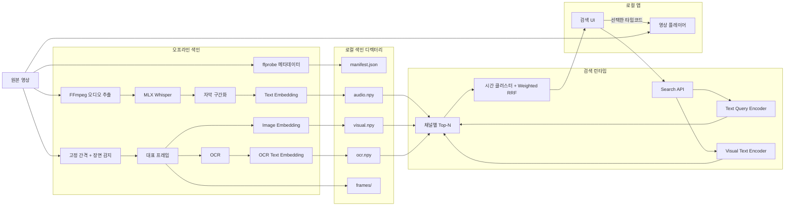
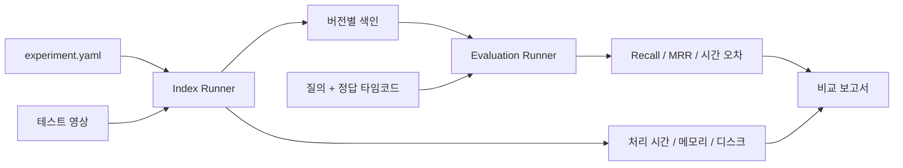

# 단일 영상 로컬 멀티모달 검색 앱 개발계획서

작업명: **영상찾기**

## 1. 개발 목표

Apple M3, 메모리 16GB 환경에서 한 개의 영상을 로컬로 색인하고 다음 검색을 제공한다.

- 발화 의미 검색
- 화면 장면 검색
- 화면 문자 검색
- 세 채널을 결합한 통합 검색
- 결과 타임코드 재생

앱은 특정 파일에 고정되지 않는다. 사용자가 로컬 파일 선택기를 통해 활성 영상 한 개를 지정하고, 필요할 때 다른 영상으로 교체할 수 있어야 한다. 검색은 현재 활성 영상만 대상으로 한다. 완료된 색인은 영상별로 보관하며, 원본 해시와 모델·설정 버전이 일치하면 다시 분석하지 않고 재사용한다.

개발은 **하네스 우선 방식**으로 진행한다. UI를 먼저 만들지 않고 색인 결과, 검색 품질, 처리 속도를 명령줄에서 재현하고 평가할 수 있게 한 뒤 앱 화면을 연결한다.

### 기준 환경과 영상

- 장비: Apple M3 MacBook Air, 통합 메모리 16GB, arm64
- 운영체제: macOS 26.3, build 25D125
- 현재 데이터 볼륨 여유 공간: 약 114GiB; 실행 시점에 다시 측정
- 기준 영상: `31784_20260609-dc91f63eb6037f85 (1).mp4`
- 현재 경로: `/Users/lucy/Documents/video sample/`
- 길이: 약 4,298.83초
- 크기: 378,816,659 bytes
- 음성: AAC, 44.1kHz, 2채널, 오디오 트랙 1개
- 언어: 한국어·영어·일본어 혼합
- 현재 환경 확인 결과: 시스템 FFmpeg와 ffprobe가 없으므로 단계 0에서 검증된 Apple Silicon 바이너리를 확보·버전 고정해 앱에 포함해야 함
- 배포 범위: 현재 Mac 한 대의 개인용 로컬 실행
- 라이선스 범위: 개인 실험은 허용하되, 동급 성능이면 상업 이용 가능한 라이선스를 우선 추천
- 제외: 계정·권한, macOS 앱 서명/공증, DMG 배포, 자동 업데이트
- 초기 UI: localhost에서 실행하는 로컬 웹 앱
- 실행 진입점: 이 Mac에서 생성한 `.app` 아이콘 더블클릭
- 실행 의존성: FFmpeg, Python 런타임, 필수 wheel을 앱 번들에 포함; Homebrew 설치 불필요
- 후속 UI: 기존 로컬 API를 재사용하는 네이티브 macOS 클라이언트
- UI 언어: 한국어만 제공; 검색어와 영상 콘텐츠는 한국어·영어·일본어 지원
- 표시 이름: `영상찾기`; 내부 데이터 디렉터리와 bundle identifier는 표시 이름 변경과 분리

## 2. 개발 원칙

1. 원본 영상은 수정하거나 복제하지 않는다.
2. 모델 추론은 로컬에서만 수행한다.
3. 색인 단계와 검색 단계를 분리한다.
4. 각 검색 채널은 독립적으로 실행·평가할 수 있어야 한다.
5. 모델의 raw score를 서로 직접 합산하지 않는다.
6. 모든 실험은 설정, 모델 버전, 처리 시간을 기록한다.
7. 실패한 실행이 완료된 색인을 덮어쓰지 않게 한다.
8. 16GB 환경에 맞춰 모델을 순차적으로 로드하고 해제한다.
9. 설치 준비는 개발자용 스크립트로 할 수 있지만, 일상적인 실행은 터미널 없이 로컬 `.app` 아이콘으로 가능해야 한다.
10. 동일한 원본 영상은 하나의 `video_id`로 관리하고 재분석 결과는 별도 `index_version`으로 보관한다.
11. 한국어·영어·일본어 질의와 교차언어 검색을 동일한 평가 체계에서 검증한다.
12. 화자 분리는 선택 기능이며 실패하거나 꺼져 있어도 기본 검색이 동작해야 한다.
13. 색인·검색 코어, 로컬 API, 웹 UI를 분리해 네이티브 UI로 교체할 수 있게 한다.
14. 색인은 빠른 검색 가능 상태와 백그라운드 보강 상태를 분리한다.
15. 장시간 영상은 작은 작업 단위로 분할하고 중단 지점부터 재개할 수 있어야 한다.
16. Gemini, OpenAI 등 유료·외부 AI API 호출을 구현에 포함하지 않는다.
17. 최초 모델 다운로드가 끝난 뒤에는 네트워크를 차단해도 색인과 검색이 동작해야 한다.
18. 장시간 작업 중 macOS 절전 방지를 사용하고 모든 종료 경로에서 해제한다.
19. 질의 입력은 텍스트만 허용하며 이미지·음성 질의용 인터페이스는 구현하지 않는다.
20. 동일 원본 영상의 공통 데이터와 모든 색인 버전의 합계는 2GB를 넘지 않아야 하며 모델 캐시와 원본 영상은 별도 집계한다.
21. 라이브러리와 모델 가중치의 라이선스를 각각 검토하고 revision과 함께 기록한다.
22. 성능 차이가 크지 않으면 상업 이용 가능한 라이선스의 후보를 기본값으로 선택한다.
23. 비상업·연구 전용 모델은 개인 실험 프로필에서만 허용하며 상용 대체 후보와 교체 영향을 함께 기록한다.
24. 런처를 여러 번 실행해도 백엔드 프로세스를 중복 생성하지 않고 기존 웹 UI만 연다.
25. 브라우저 수명과 백엔드 수명을 분리하고, 백엔드 상태 및 종료 제어는 메뉴 막대 아이콘에서 제공한다.
26. 모델은 최초 실행 설정에서 명시적 확인 후 자동 다운로드하고, 설치 완료 뒤 핵심 기능은 오프라인으로 동작한다.
27. 사용자 환경의 Python, FFmpeg, Homebrew에 의존하지 않고 앱 번들 안의 고정 버전을 실행한다.
28. 사용자에게 노출되는 UI 문구와 복구 안내는 한국어로 작성하되 원문 데이터는 번역으로 덮어쓰지 않는다.
29. 앱 표시 이름 변경이 기존 색인과 모델 캐시 경로를 바꾸지 않도록 안정적인 내부 식별자를 사용한다.

## 3. 권장 기술 구성

| 영역 | 권장 기술 | 선택 이유 |
|---|---|---|
| 언어 | Python 3.11 또는 3.12 | MLX 및 영상 AI 생태계 호환성 |
| 영상·오디오 | FFmpeg/ffprobe | 안정적인 미디어 변환과 메타데이터 추출 |
| 음성인식 | MLX Whisper | Apple Silicon 최적화, 로컬 실행 |
| 음성 구간 감지 | Whisper 기본 구간 또는 Silero VAD | 무음 제거와 구간 품질 개선 |
| 화자 분리 | 로컬 diarization 모델, 선택 기능 | 여러 사람의 발화를 Speaker 단위로 구분 |
| 텍스트 임베딩 | multilingual E5 계열 | 한국어·영어·일본어 교차언어 의미 검색과 비교적 작은 모델 크기 |
| 번역 | 경량 다국어 로컬 번역 모델 | 검색 결과 원문을 질의 언어로 보조 표시 |
| 화면 임베딩 | CLIP 계열 이미지 인코더 + 다국어 text adapter | 세 언어 문장과 프레임의 직접 비교 |
| 장면 감지 | PySceneDetect | 화면 전환 기반 대표 프레임 확보 |
| OCR | 한국어·영어·일본어를 지원하는 로컬 OCR 구성 | 세 언어의 화면 문자 검색 |
| 색인 저장 | JSON + NumPy `.npy`/`.npz` | 단일 영상에서 DB 없이 충분 |
| API | FastAPI | 검색·상태 API 구현이 단순함 |
| 초기 UI | HTML/CSS/JavaScript 기반 로컬 웹 | 타임코드 재생과 빠른 검증에 적합 |
| macOS 실행기 | 얇은 로컬 `.app` 런처와 메뉴 막대 상태 항목 | 백엔드 시작, 준비 확인, 기본 브라우저 열기, 종료 제어 |
| 배포 런타임 | Apple Silicon용 자체 포함 앱 번들 | Python·FFmpeg 별도 설치 없이 동일한 실행 환경 보장 |
| 후속 UI | SwiftUI 등 네이티브 클라이언트 | 동일한 로컬 API 재사용, 별도 단계 |
| 테스트 | pytest | 단위·통합·성능 테스트 통합 |

금지 사항:

- 영상, 오디오, 프레임 또는 자막을 외부 AI API로 전송
- API 키를 요구하는 핵심 기능
- 호출량에 따라 비용이 발생하는 임베딩·번역·OCR 서비스

모델명은 구현 전에 작은 샘플로 정확도와 메모리 사용량을 비교한 뒤 고정한다. 라이브러리 라이선스뿐 아니라 모델 가중치의 상업적 이용 조건도 별도로 확인한다.

### 3.1 라이선스 선택 규칙

각 의존성과 모델에 대해 다음 항목을 `licenses.md` 또는 동등한 기계 판독 가능 목록에 기록한다.

- 이름과 정확한 버전 또는 모델 revision
- 공식 배포 출처와 라이선스 원문 링크
- 코드 라이선스와 모델 가중치 라이선스
- 개인 이용, 상업 이용, 수정, 재배포 가능 여부
- 저작자 표시, 고지문 포함 등 준수할 조건
- `상업 사용 가능`, `개인 실험 전용`, `검토 필요` 중 하나의 판정
- 개인 실험 전용인 경우 상업 이용 가능한 대체 후보와 예상 재색인 범위

Claude 구현 시의 기본 결정 규칙은 다음과 같다.

1. 정확도·속도·메모리가 수용 범위인 후보 중 상업 이용 가능한 라이선스를 우선한다.
2. 라이선스가 불명확하면 기본 후보에서 제외하고 `검토 필요`로 남긴다.
3. 비상업·연구 전용 후보가 품질상 꼭 필요하면 설정 플래그로 분리하고 기본값으로 켜지 않는다.
4. 제한 모델로 만든 색인에는 해당 모델과 라이선스 등급을 manifest에 기록한다.
5. 모델 어댑터 경계를 유지해 향후 상용 후보로 교체하고 해당 채널만 재색인할 수 있게 한다.
6. 이 검토는 법률 자문이 아니므로 실제 상용 배포 전에는 라이선스를 다시 확인한다.

## 4. 시스템 설계도

### 4.1 전체 구조



### 4.2 개발 하네스



## 5. 디렉터리 설계안

```text
project/
├── app/
│   ├── api/
│   ├── frontend/
│   └── services/
├── pipeline/
│   ├── media.py
│   ├── transcription.py
│   ├── frame_extraction.py
│   ├── ocr.py
│   ├── embedding.py
│   └── index_builder.py
├── retrieval/
│   ├── audio_search.py
│   ├── visual_search.py
│   ├── ocr_search.py
│   ├── fusion.py
│   └── temporal_merge.py
├── harness/
│   ├── index_runner.py
│   ├── evaluate.py
│   ├── benchmark.py
│   └── report.py
├── configs/
│   ├── default.yaml
│   └── experiments/
├── eval/
│   ├── queries.json
│   └── fixtures/
├── data/
│   ├── indexes/
│   │   └── {video_id}/
│   │       ├── shared/                 # 버전 간 공통 파생 데이터
│   │       ├── versions/{index_version}/
│   │       └── experiments.jsonl       # 정리 후에도 남기는 경량 이력
│   └── work/
├── tests/
└── docs/
```

## 6. 데이터 설계

### 6.1 색인 manifest

```json
{
  "schema_version": 1,
  "index_id": "20261019-001",
  "video": {
    "path": "/absolute/path/video.mp4",
    "sha256": "...",
    "duration_ms": 3812000,
    "size_bytes": 2048576000
  },
  "models": {
    "asr": "model-name-and-revision",
    "text_embedding": "model-name-and-revision",
    "visual_embedding": "model-name-and-revision",
    "ocr": "model-name-and-revision"
  },
  "settings": {
    "frame_interval_seconds": 2,
    "scene_detection": true,
    "target_audio_chunk_seconds": 12
  },
  "channels": {
    "audio": true,
    "visual": true,
    "ocr": true
  },
  "storage": {
    "shared_bytes": 0,
    "version_bytes": 0,
    "video_total_bytes": 0,
    "video_limit_bytes": 2000000000
  }
}
```

### 6.2 발화 구간

```json
{
  "id": "audio-000142",
  "start_ms": 1122400,
  "end_ms": 1143800,
  "text": "서버를 계속 실행하지 않고 필요할 때만 사용하면...",
  "speaker_id": "speaker_01",
  "speaker_label": "Speaker 1",
  "embedding_row": 142
}
```

### 6.3 화면 프레임

```json
{
  "id": "visual-000231",
  "timestamp_ms": 1130000,
  "filename": "frame_000231.jpg",
  "source": "interval|scene",
  "ocr_text": "GPU COST COMPARISON",
  "visual_embedding_row": 231,
  "ocr_embedding_row": 87
}
```

임베딩 행 순서와 메타데이터 순서는 반드시 일치해야 한다. 저장 전에 개수와 ID 대응을 검증한다.

## 7. 색인 파이프라인 상세

### 7.1 사전 검사

- 영상 파일 존재 여부
- FFmpeg 실행 가능 여부
- 영상 길이, 크기, 코덱 확인
- 사용 가능한 디스크 공간 확인
- 기존 색인과 원본 영상 해시 비교
- SHA-256이 같은 기존 영상 및 색인 버전 조회
- 예상 프레임 수와 작업량 계산
- 현재 영상의 공통 데이터·전체 버전 사용량과 새 버전의 예상 추가 용량 계산
- 재분석 후 합계가 2GB를 넘으면 용량 선택 화면으로 전환하고 색인을 시작하지 않음

### 7.2 음성 처리

1. 16kHz mono WAV 추출
2. Whisper 음성인식 및 단어/문장 타임코드 생성
3. 빈 문장과 비정상 타임코드 제거
4. 목표 10~15초, 최대 25초 기준으로 인접 발화 병합
5. 문맥 손실 방지를 위해 필요하면 짧은 overlap 적용
6. 화자 분리 옵션이 켜졌으면 발화 구간과 화자 타임라인 정렬
7. 텍스트 임베딩 생성 및 정규화

초기 비교 대상:

- Whisper `medium`
- Whisper `turbo`
- 필요한 경우 4비트 양자화 모델

정확도, 실시간 배수, 최대 메모리를 측정해 하나를 기본값으로 선정한다.

### 7.3 화면 처리

두 종류의 프레임 후보를 합친다.

- 고정 간격 프레임: 기본 최대 2초
- 장면 전환 대표 프레임: 각 장면의 중앙 프레임

시간이 지나치게 가까운 프레임은 perceptual hash 또는 시간 기준으로 중복 제거한다. 각 프레임에서 다음을 생성한다.

- 검색용 축소 JPEG
- 이미지 임베딩
- OCR 텍스트
- OCR 텍스트 임베딩

3초 타임코드 오차 기준을 맞추기 위해 2초 간격을 기본 후보로 사용한다. 빠른 색인에서는 더 성긴 간격을 임시 사용할 수 있지만, 전체 기본 검색 범위 완료 시점에는 2초 간격 또는 동등 이상의 시간 정밀도를 확보해야 한다. 처리 시간과 2GB 제한을 함께 평가한다.

### 7.4 안전한 색인 저장

1. 임시 작업 디렉터리에 결과 생성
2. 메타데이터와 벡터 행 개수 검증
3. 샘플 벡터의 norm과 NaN 검사
4. manifest를 마지막에 기록
5. 완료된 디렉터리를 원자적으로 활성 색인으로 교체
6. 실패하면 기존 활성 색인을 유지

### 7.5 단계적 색인과 시간 목표

약 1시간 영상 기준으로 다음 두 단계를 운영한다.

#### 빠른 색인 — 목표 5분 이내

- 오디오 추출과 다국어 음성인식
- 발화 구간 및 텍스트 임베딩
- 성긴 간격의 대표 프레임과 이미지 임베딩
- 검색 가능한 최소 manifest

완료 즉시 발화 검색과 기본 화면 검색을 활성화한다. 기준 영상은 약 71.6분이므로 전체 파이프라인이 약 14.3배속 이상인지 하네스에서 측정한다. 5분 목표를 달성하지 못하면 단계별 병목과 실제 측정값을 보고하고 품질을 임의로 낮추지 않는다.

#### 추가 분석 — 백그라운드

- 장면 전환 기반 추가 프레임
- OCR 및 OCR 임베딩
- 선택적 화자 분리
- 검색 결과 구간의 주문형 번역과 캐시
- 정밀 중복 제거 및 색인 최적화

추가 분석 중에도 빠른 색인은 유지한다. 각 채널은 완료되는 즉시 원자적으로 활성화하며, 실패한 채널은 다른 채널의 검색을 막지 않는다.

### 7.6 최대 10시간 영상 처리

- 입력 영상 최대 길이: 10시간 이상을 최소 지원 기준으로 설정
- 초기 입력 형식: `.mp4`만 허용
- 등록 시 MP4 컨테이너, 영상 스트림, 오디오 스트림을 검사하고 미지원 코덱은 분석 전에 안내
- 작업 단위: 기본 15~30분 구간, 정확한 크기는 하네스에서 결정
- 최초 검색 시작: 실행 후 5분 이내, 완료된 구간 대상
- 전체 기본 검색 범위: 10시간 영상 기준 1시간 이내 목표
- 전체 기본 검색은 발화 검색과 성긴 프레임 기반 화면 검색을 포함
- OCR, 화자 분리, 장면 전환 프레임과 번역은 후속 보강 단계로 처리
- 구간별 상태, 재시도 횟수, 모델 버전을 checkpoint에 기록
- 프로세스 종료 후 동일 설정으로 다시 실행하면 미완료 구간부터 재개
- 검색 응답에 전체 영상 대비 분석 완료 범위를 포함
- 브라우저 연결 상태와 무관하게 로컬 백엔드 작업을 계속 실행
- 작업 중 `caffeinate` 또는 macOS power assertion을 사용하고 완료·취소·실패 시 정리

10시간을 1시간 안에 처리하려면 기본 파이프라인이 최소 10배속이어야 한다. 구현 완료를 선언하기 전에 실제 10시간급 영상 또는 반복 가능한 동등 부하 fixture로 측정한다. 목표 미달 시 병목과 측정치를 보고하고 무단으로 품질 설정을 낮추지 않는다.

## 8. 검색 설계

### 8.1 채널별 검색

- 발화: E5 질의 벡터와 발화 벡터 cosine similarity
- 화면: 다국어 visual-text 질의 벡터와 이미지 벡터 cosine similarity
- OCR: E5 질의 벡터와 OCR 벡터 검색 + 정확 문자열 보조 점수

각 채널에서 넉넉한 후보를 먼저 가져온다.

```text
audio top 30
visual top 30
ocr top 30
```

### 8.2 시간축 병합

후보 중심 시점이 일정 범위 안에 있으면 같은 결과로 묶는다.

- 기본 병합 범위: ±5초
- 발화 구간은 실제 시작·종료 시간을 유지
- 화면 결과만 있는 경우 대표 프레임 앞뒤 2~3초를 재생 구간으로 사용
- 한 클러스터에는 채널별 최고 근거 하나를 유지

### 8.3 순위 결합

서로 다른 모델의 raw score 범위가 다르므로 Weighted Reciprocal Rank Fusion을 기본으로 사용한다.

```text
score = audio_weight / (k + audio_rank)
      + visual_weight / (k + visual_rank)
      + ocr_weight / (k + ocr_rank)
```

초기 가중치:

| 모드 | 발화 | 화면 | OCR |
|---|---:|---:|---:|
| 통합 | 0.45 | 0.40 | 0.15 |
| 발화 | 0.85 | 0.00 | 0.15 |
| 화면 | 0.00 | 0.80 | 0.20 |

최종 가중치는 평가 데이터로 결정한다.

### 8.4 결과 반환

```json
{
  "start_ms": 1122400,
  "end_ms": 1143800,
  "relative_score": 0.91,
  "channels": ["audio", "visual"],
  "transcript": "서버를 계속 실행하지 않고...",
  "transcript_language": "ko",
  "translated_text": "If the server is only used when needed...",
  "translation_language": "en",
  "ocr_text": "GPU COST COMPARISON",
  "thumbnail": "frames/frame_000231.jpg"
}
```

### 8.5 관련 결과 없음 판정

- 발화·화면·OCR 채널별로 별도의 신뢰도 임계값을 둔다.
- raw cosine 값을 확률로 해석하지 않는다.
- 정답이 없는 부정 질의를 평가 세트에 포함해 임계값을 보정한다.
- 통합 검색 결과도 기여 채널 중 하나 이상이 최소 신뢰 조건을 통과해야 한다.
- 조건을 통과한 후보가 없으면 빈 결과와 `no_confident_result` 상태를 반환한다.
- 임계값은 실험 설정과 보고서에 기록하고 근거 없이 변경하지 않는다.

## 9. 앱 설계

### 9.0 실행 구조

첫 버전은 전체 화면을 네이티브로 다시 만들지 않는다. 이 Mac 전용의 얇은 `.app` 런처가 다음 순서만 담당한다.

1. 앱 지원 디렉터리와 Python 실행 환경이 준비되어 있는지 확인한다.
2. lock 또는 로컬 health endpoint로 기존 백엔드 실행 여부를 확인한다.
3. 실행 중이 아니면 로컬 백엔드를 시작한다.
4. `/api/status`가 준비 상태가 될 때까지 진행 상태를 표시한다.
5. 운영체제의 기본 브라우저로 localhost 웹 UI를 연다.
6. 이미 실행 중이면 새 프로세스를 만들지 않고 기존 웹 UI만 연다.
7. 백엔드가 실행되는 동안 메뉴 막대에 상태 아이콘을 유지한다.

백엔드는 `127.0.0.1`에만 바인딩하고 외부 네트워크 인터페이스에 공개하지 않는다. 포트 충돌 시 외부 접근 가능 주소로 우회하지 말고 사용 가능한 로컬 포트를 선택해 런처와 공유한다. 현재 Mac에서 직접 빌드하는 개인 실험용 앱이므로 Developer ID 서명·공증·DMG 제작은 요구하지 않는다.

앱 번들은 Apple Silicon 전용으로 만든다. Python 런타임, 애플리케이션 패키지, FFmpeg/ffprobe와 필요한 동적 라이브러리를 포함하고 절대 경로가 아닌 번들 상대 경로로 실행한다. 사용자 시스템의 `python`, `ffmpeg`, Homebrew 경로는 사용하지 않는다. AI 모델 캐시는 크기와 교체 주기가 다르므로 `.app` 외부의 앱 지원 디렉터리에 둔다.

빌드 과정은 포함 파일 목록과 버전을 lockfile로 고정하고, 새 Mac 사용자 계정과 네트워크 차단 상태에서 실행 smoke test를 수행한다. FFmpeg는 빌드 옵션에 따라 라이선스 조건이 달라질 수 있으므로 실제 포함 바이너리의 configure flags, 라이선스, 고지문을 `licenses.md`에 기록한다.

메뉴 막대 메뉴의 최소 항목은 다음과 같다.

- `검색 화면 열기`: 기본 브라우저에서 현재 localhost 주소를 연다.
- `상태`: 대기, 분석 중과 진행률, 검색 가능·보강 중, 완료, 오류를 읽기 전용으로 표시한다.
- `앱 종료`: 분석 중이면 확인 대화상자를 표시한다. 확인 후 새 작업 수락을 중단하고 checkpoint를 원자적으로 저장하며 worker와 백엔드를 순서대로 종료한다.

정상 종료, 취소, 오류 모두에서 macOS 절전 방지 assertion과 lock 파일을 해제한다. 강제 종료가 발생한 경우 다음 실행에서 stale lock을 판별하고 마지막 checkpoint부터 복구한다.

### 9.0.1 최초 실행과 모델 설치

모델이 준비되지 않은 첫 실행에는 검색 화면보다 먼저 설정 화면을 연다.

1. 채택한 모델의 이름, revision, 역할, 개별 용량과 전체 예상 다운로드 용량을 표시한다.
2. 기본 모델 캐시 위치와 설치 후 남을 것으로 예상되는 디스크 공간을 표시한다.
3. 각 모델의 라이선스 등급과 공식 원문 링크를 표시한다.
4. 사용자가 확인하면 앱이 필요한 파일을 자동 다운로드한다.
5. 진행률, 현재 파일, 받은 용량, 전체 용량과 오류를 표시한다.
6. 부분 파일로 이어받기를 지원하고 취소·네트워크 단절 후 다음 실행에서 재개한다.
7. 공식 checksum이 있으면 이를 사용하고, 없으면 다운로드 완료 후 파일 크기와 로딩 검사를 수행한다.
8. 검증이 끝난 파일만 최종 모델 캐시로 원자적으로 이동한다.
9. 모든 필수 모델이 준비되면 네트워크를 차단한 상태에서 사전 검사와 짧은 추론 smoke test를 수행한다.

모델 버전은 설정에 고정하며 앱이 임의로 최신 버전으로 바꾸지 않는다. 업데이트는 별도 사용자 동작으로만 수행하고, 변경 시 영향받는 색인 채널과 재색인 필요 여부를 먼저 알린다. 미완료 다운로드와 검증 실패 파일은 완성 모델로 취급하지 않는다.

### 9.1 앱 상태

```text
NO_VIDEO
  → READY_TO_INDEX
  → QUICK_INDEXING
  → SEARCH_READY_ENRICHING
  → SEARCH_READY_COMPLETE
  → PAUSED_RESUMABLE
  → INDEX_FAILED
```

앱이 다시 실행될 때 manifest와 원본 영상 해시를 확인해 상태를 복원한다.
영상 교체 시 기존 색인은 삭제하지 않는다. 영상 라이브러리에는 파일명, 길이, 원본 경로, 색인 상태, 마지막 사용 시각, 색인 크기를 표시한다. 원본이 이동했으면 새 경로를 다시 연결할 수 있어야 한다. 사용자가 명시적으로 삭제할 때만 해당 영상의 프레임·자막·임베딩을 제거한다.

동일 파일 선택 시에는 다음 상태 전이를 사용한다.

```text
FILE_SELECTED
  → HASHING
  → DUPLICATE_FOUND
      ├─ OPEN_EXISTING → SEARCH_READY
      ├─ REINDEX_AS_NEW_VERSION → INDEXING
      └─ CANCEL → 이전 상태
```

`REINDEX_AS_NEW_VERSION`은 새 영상 레코드를 만들지 않는다. 기존 `video_id` 아래에 새로운 `index_version`을 만들고 완료 후 활성 버전으로 전환한다. 이전 버전은 비교와 롤백을 위해 보존하며 사용자가 명시적으로 삭제할 수 있다.

재분석 전 용량 판정은 다음 규칙을 따른다.

```text
예상 합계 = 현재 video_id의 실제 사용량 + 새 버전 예상 추가량 - 재사용 가능한 공통 데이터

예상 합계 <= 2GB → 분석 시작 가능
예상 합계 > 2GB  → 오래된 버전 정리 선택 또는 취소
```

앱은 정리 대상을 자동 선택하지 않는다. 사용자가 버전을 선택하면 삭제 예정 용량과 삭제 후 예상 합계를 다시 보여주고 확인을 받은 뒤 대용량 산출물만 제거한다. 모델·설정·평가 지표·처리 시간·오류 기록은 `experiments.jsonl`에 유지한다. 공유 파일은 참조 수가 0일 때만 삭제하며, 중단되거나 실패한 새 버전은 활성 버전에 영향을 주지 않는다.

### 9.2 API 초안

```http
GET  /api/status
GET  /api/videos
POST /api/videos/select
DELETE /api/videos/{video_id}/index
GET  /api/videos/{video_id}/indexes
POST /api/videos/{video_id}/indexes/{index_version}/activate
DELETE /api/videos/{video_id}/indexes/{index_version}/artifacts
GET  /api/videos/{video_id}/storage-estimate
POST /api/index
POST /api/index/cancel
POST /api/search
GET  /api/index/progress
GET  /media/video
GET  /media/frames/{frame_id}
```

### 9.3 UI 완료 조건

- 영상 선택과 분석 시작이 가능하다.
- 분석 단계와 진행률이 보인다.
- 통합·발화·화면 모드를 선택할 수 있다.
- 결과 카드에 썸네일, 시간, 근거가 표시된다.
- 결과 자막과 질의 언어가 다르면 원문과 번역문이 함께 표시된다.
- 화자 분리를 사용한 영상은 결과에 화자 라벨과 화자 필터를 제공한다.
- 화자 관리 화면에서 `Speaker 1` 등의 라벨을 수정하고 영상별로 저장할 수 있다.
- 결과 선택 시 `video.currentTime`이 변경되고 재생된다.
- 색인이 없거나 원본이 이동한 상태를 명확히 안내한다.
- 모델 로딩 중 검색 버튼의 중복 실행을 방지한다.
- 버튼, 상태, 경고, 오류와 복구 방법을 한국어로 표시한다.
- 원문 자막·OCR은 그대로 표시하고 번역문은 별도 필드로 구분한다.

## 10. 하네스 설계

### 10.1 설정 파일

각 실험은 다음 값을 기록한다.

- 모델 이름과 revision
- 프레임 추출 전략과 간격
- 음성 chunk 길이
- 채널별 후보 수
- 시간 병합 범위
- RRF 상수와 가중치
- 실행 장비 및 소프트웨어 버전

### 10.2 평가 데이터

```json
[
  {
    "id": "q001",
    "query": "비용을 줄이는 방법을 설명하는 부분",
    "category": "audio_semantic",
    "mode": "audio",
    "expected_ranges": [[1120000, 1160000]]
  },
  {
    "id": "q002",
    "query": "빨간 자동차가 터널로 들어가는 장면",
    "category": "visual_action",
    "mode": "visual",
    "expected_ranges": [[1930000, 1955000]]
  }
]
```

평가 세트 작성 책임자는 Claude다. 사용자에게 질의 작성, 정답 구간 지정 또는 결과 판정을 요청하지 않는다.

작성 절차:

1. 기준 영상의 메타데이터와 시간축을 확인하고 구간별로 균등하게 표본을 잡는다.
2. 원본 영상을 직접 재생하고 발화·화면·OCR 근거가 분명한 장면을 기록한다.
3. 검색 시스템을 실행하기 전에 자연스러운 질의와 허용 정답 구간을 작성한다.
4. 각 정답 구간을 다시 재생해 시작·종료 시점과 근거를 검증한다.
5. 평가 파일의 hash를 기록하고 모델 비교 중에는 고정한다.
6. 검색 결과를 그대로 정답으로 채택하거나, 평가 대상 모델로 정답을 자동 생성하는 순환 평가를 금지한다.

최소 구성은 30개다.

- 발화 의미 및 바꿔 말한 질의 10개 이상
- 질의 언어와 발화 언어가 다른 교차언어 질의 5개 이상
- 사물·행동·장면 화면 질의 7개 이상
- 화면 문자 OCR 질의 3개 이상
- 영상에 정답이 없는 부정 질의 5개 이상

한 질의가 둘 이상의 범주에 포함될 수 있다. 한국어·영어·일본어는 실제 영상에 해당 근거가 존재하는 범위에서 모두 포함하고, 특정 언어 근거가 부족하면 이를 보고서에 기록한다. 20개 이상은 개발·임계값 보정용으로, 별도의 10개 이상은 최종 holdout으로 사용한다. holdout을 확인한 뒤 설정을 바꾸면 새 holdout을 작성하거나 변경 사실을 보고서에 명시한다.

질의 범주:

- 정확한 발화
- 의미가 같은 발화
- 고유명사와 숫자
- 사물
- 행동
- 장면 구성
- 화면 문자
- 정답이 없는 질의
- 한국어 질의로 영어·일본어 발화 찾기
- 영어 질의로 한국어·일본어 발화 찾기
- 일본어 질의로 한국어·영어 발화 찾기

### 10.3 측정 지표

- Recall@1, Recall@5
- MRR@5
- 결과와 정답 구간의 시간 중첩
- Top-1 중심 시점 오차
- 정답 대비 결과 시작 시점의 3초 허용 오차 통과율
- 영상 1분당 색인 시간
- 채널별 처리 시간
- 질의 언어별 및 질의-발화 언어 조합별 Recall@5
- 최대 메모리 사용량
- 색인 디스크 사용량
- 검색 p50/p95 응답 시간

### 10.4 비교 보고서

각 실험 결과는 JSON과 Markdown으로 남긴다.

```text
실험 A: frame=10s, audio=turbo
실험 B: frame=5s, audio=turbo

비교:
- visual Recall@5: 0.62 → 0.78
- 색인 시간: 8분 → 12분
- 디스크: 310MB → 520MB
```

모델이나 파라미터를 변경할 때 기존 기준 실험보다 품질이 낮아지면 기본 설정을 변경하지 않는다.

## 11. 테스트 계획

### 단위 테스트

- 자막 구간 병합
- 타임코드 변환
- 벡터 정규화와 cosine 계산
- 채널별 Top-K
- 시간 클러스터링
- Weighted RRF
- 경로 검증
- manifest schema 검증

### 통합 테스트

- 1~2분짜리 fixture 영상 전체 색인
- 오디오가 없는 영상의 화면 검색
- 화면 변화가 적은 영상
- 한국어·영어·일본어 OCR이 포함된 화면 또는 슬라이드 영상
- 색인 도중 강제 중단 후 재시작
- 원본 영상 이동 또는 삭제 상태
- 앱 재실행 후 색인 재사용

### 수동 인수 테스트

- 실제 대상 영상 전체 색인
- Claude가 원본 영상으로 검증해 고정한 30개 이상 질의 실행
- 결과 카드에서 정확한 시점 재생 확인
- 네트워크를 끈 상태에서 검색 가능 여부 확인
- 앱 종료 후 재실행 확인

## 12. 단계별 개발 일정

### 단계 0 — 환경 및 샘플 확정

산출물:

- 대상 영상 특성 기록
- Python 실행 환경 구성
- 번들에 포함할 FFmpeg/ffprobe 바이너리 확보, 버전·빌드 옵션·라이선스 기록
- 라이선스 검토표
- 상업 이용 가능 여부와 개인 실험 전용 항목을 구분한 `licenses.md`
- 원본 재생으로 검증한 평가 질의 초안 30개 이상과 development/holdout 분리
- 기준 영상 SHA-256 기록

완료 조건:

- 대상 영상을 FFmpeg로 정상 읽을 수 있다.
- 모델 저장 공간이 확보되어 있다.
- 최초 실행 모델 목록, 예상 용량, 라이선스 표시와 이어받기 정책이 확정되어 있다.
- 기준 영상의 영상 코덱, 해상도, 프레임레이트까지 manifest에 기록된다.

### 단계 1 — 음성 검색 하네스

작업:

- 오디오 추출
- MLX Whisper 연결
- 타임코드 자막 구간화
- 텍스트 임베딩 생성
- CLI 검색
- 발화 평가 지표 구현

완료 조건:

- 발화 질의가 정답 타임코드를 상위 5개 안에서 찾는다.
- 동일 설정으로 재실행하면 같은 결과를 낸다.

### 단계 2 — 화면 및 OCR 검색 하네스

작업:

- 고정 간격 프레임 추출
- 장면 전환 프레임 추출
- 중복 프레임 제거
- 이미지 임베딩
- 한국어·영어·일본어 OCR 및 텍스트 임베딩
- 화면·OCR 평가 지표 구현

완료 조건:

- 화면 사물·행동 질의와 OCR 질의를 각각 검색할 수 있다.
- 프레임 전략별 품질과 처리 비용 보고서가 생성된다.

### 단계 3 — 멀티모달 결합

작업:

- 시간 후보 클러스터링
- Weighted RRF
- 모드별 가중치
- 근거 선택
- 통합 회귀 평가

완료 조건:

- 통합 검색이 개별 채널의 강점을 유지한다.
- 채널 추가로 기존 발화 검색 성능이 유의미하게 하락하지 않는다.

### 단계 4 — 검색 앱

작업:

- 로컬 API
- `.app` 실행기에서 백엔드 기동 및 기본 브라우저 열기
- 중복 실행 방지와 localhost health check
- 메뉴 막대 상태 표시, 화면 다시 열기, 안전 종료
- 영상 선택과 분석 실행
- 진행률 표시
- 검색 UI
- 결과 타임코드 재생
- 오류 및 재색인 화면

완료 조건:

- 명령줄 없이 영상 선택부터 검색까지 수행할 수 있다.

### 단계 5 — 안정화

작업:

- 전체 인수 테스트
- 메모리와 디스크 최적화
- 중단·재개 및 실패 복구
- 설치와 실행 문서
- 이 Mac용 `.app` 런처 생성 절차
- 자체 포함 런타임과 FFmpeg가 있는 Apple Silicon 앱 번들 빌드
- 기준 평가 보고서 고정

완료 조건:

- 기획서의 제품 완료 기준과 품질 목표를 충족한다.

## 13. 구현 우선순위

```text
P0  발화 색인과 검색
P0  화면 프레임 색인과 검색
P0  타임코드 결과와 재생
P0  평가 하네스
P1  OCR 검색
P1  통합 순위 결합
P1  선택적 화자 분리와 화자 필터
P1  중단·재시작과 진행률
P2  자막 및 평가 보고서 내보내기
```

화면 검색은 필수 범위이므로 UI 이후로 미루지 않는다. 발화 하네스가 안정화된 직후 화면 하네스를 구현한다.

## 14. 성능 및 자원 전략

- 음성인식, 이미지 임베딩, OCR 모델을 순차적으로 로드한다.
- 프레임 이미지는 검색 UI에 필요한 크기로 축소한다.
- 원본 영상은 색인 디렉터리에 복사하지 않는다.
- 모델 캐시는 약 4~8GB 범위로 예상하고 영상별 2GB 색인 제한에서 제외한다.
- 2GB는 같은 `video_id`의 `shared/`와 `versions/` 전체 실제 디스크 사용량 합계에 적용한다.
- 분석 전에 예상 프레임 수와 새 버전의 추가 저장량을 계산하고, 합계가 2GB를 넘으면 분석을 차단한 뒤 정리 또는 취소를 요청한다.
- 자동 삭제는 금지한다. 사용자가 정리할 버전을 직접 고르고 예상 확보 용량을 확인한 뒤 실행한다.
- 프레임·오디오 중간 산출물은 콘텐츠 해시와 참조 수로 관리해 버전 간 중복 저장을 피한다.
- 버전 산출물을 정리해도 설정과 평가 결과를 담은 경량 실험 이력은 유지한다.
- 2GB 제한을 맞출 때는 프레임 간격, JPEG 크기, 임베딩 정밀도를 실험 설정으로 조정하고 변경 내용을 기록한다.
- 임베딩은 `float32`로 시작하고 필요할 때 `float16` 저장을 비교한다.
- 검색용 행렬은 메모리 매핑을 검토한다.
- UI 서버는 AI 색인 프로세스와 분리해 분석 실패가 앱을 종료시키지 않게 한다.
- 모델 캐시 크기와 색인 크기를 앱 상태 화면에 표시한다.
- 모델 캐시는 앱 데이터와 분리된 전용 디렉터리에 두고 UI에서 실제 경로를 확인할 수 있게 한다.

## 15. 예상 위험과 개발 대응

### 다국어 화면 검색 품질

한국어·일본어 text-to-image 검색이 약하면 다음 순서로 대응한다.

1. 다국어 CLIP adapter 비교
2. OCR 채널 강화
3. 로컬 번역 후 영어 visual query 비교
4. 소형 image caption 모델을 별도 실험으로 추가

caption 모델은 메모리와 처리 비용이 크므로 기본 파이프라인에 바로 포함하지 않는다.

### 짧은 장면 누락

고정 간격을 무조건 줄이면 비용이 증가한다. 장면 전환 프레임을 추가하고 평가 데이터에서 누락된 구간만 분석해 간격을 결정한다.

### 메모리 부족

- 모델 순차 실행
- 작은 배치
- 양자화 모델 비교
- 추론 후 명시적 객체 해제
- 검색 앱에서는 query encoder만 유지

### 타임코드 부정확성

- Whisper segment와 word timestamp 비교
- 발화 검색은 word timestamp를 사용해 구간 시작점을 보정
- 결과 재생 시 탐지 시점보다 1~2초 앞에서 시작
- 평가에서는 구간 overlap과 중심 시점 오차를 함께 사용

## 16. 최종 인수 체크리스트

- [ ] 대상 영상이 로컬에서 정상 분석된다.
- [ ] 발화·화면·OCR 색인이 각각 생성된다.
- [ ] 색인과 모델 버전을 확인할 수 있다.
- [ ] 통합·발화·화면 검색이 동작한다.
- [ ] 상위 결과에 타임코드와 근거가 표시된다.
- [ ] 결과 선택 시 해당 위치부터 재생된다.
- [ ] 앱 재실행 후 색인을 재사용한다.
- [ ] 앱 아이콘을 더블클릭하면 터미널 없이 백엔드와 웹 UI가 열린다.
- [ ] 앱 아이콘을 다시 실행해도 백엔드가 중복 실행되지 않는다.
- [ ] 브라우저를 닫아도 분석이 계속되고 메뉴 막대에서 화면을 다시 열 수 있다.
- [ ] 분석 중 앱 종료 시 확인, checkpoint 저장, worker 종료, 절전 방지 해제가 수행된다.
- [ ] Homebrew·시스템 Python·시스템 FFmpeg가 없는 환경에서도 앱 번들만으로 실행된다.
- [ ] 네트워크 연결 없이 검색한다.
- [ ] 최초 모델 다운로드가 사용자 확인 후 진행되고 중단 후 이어받을 수 있다.
- [ ] 모델 설치 완료 뒤 네트워크를 끈 상태에서 smoke test가 통과한다.
- [ ] 실패한 재색인이 기존 색인을 손상시키지 않는다.
- [ ] 평가 하네스가 기준 보고서를 생성한다.
- [ ] 실제 질의 세트에서 합의한 품질 목표를 충족한다.
- [ ] 사용자 화면과 오류 복구 안내가 한국어로 제공되고 원문 데이터가 보존된다.

## 17. Claude 개발 착수 지침

Claude가 구현할 때는 다음 순서를 지킨다.

1. 이 계획과 기획서의 범위를 먼저 확인한다.
2. 대상 영상과 평가 질의 없이 UI부터 구현하지 않는다.
3. 단계 1의 CLI 하네스와 테스트를 먼저 완성한다.
4. 각 단계 종료 시 실행 명령, 테스트 결과, 측정값을 문서화한다.
5. 모델을 추가하기 전에 16GB 환경의 최대 메모리를 측정한다.
6. 기존 실험 결과를 덮어쓰지 않고 새로운 실험 ID로 저장한다.
7. 완료 여부는 화면 구현이 아니라 인수 체크리스트와 평가 지표로 판단한다.
8. 평가 질의와 정답 타임코드는 Claude가 원본 영상에서 직접 만들고 검증하며 사용자 작업을 전제로 두지 않는다.
9. 평가 대상 검색 결과를 정답 데이터 생성에 재사용하지 않는다.

