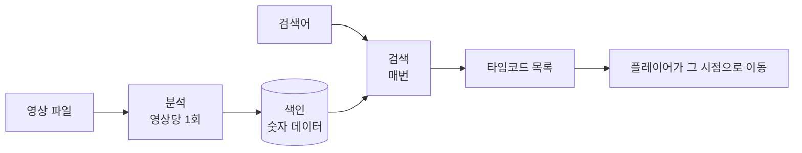
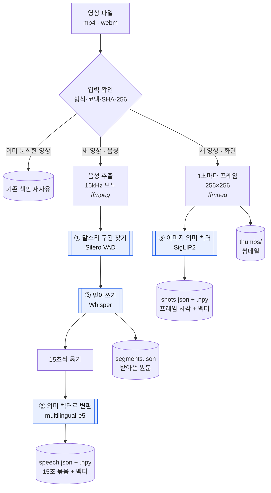
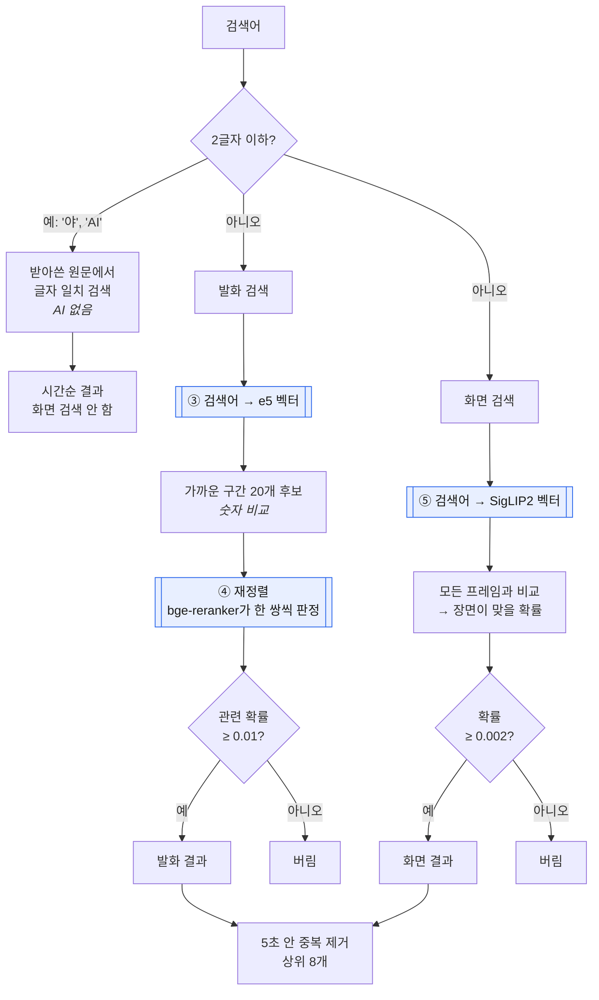

# 영상 분석 · 검색 구조

영상찾기가 영상 하나를 어떻게 분석하고 검색하는지, 그리고 **어느 단계에서 어떤 AI를 무엇에 쓰는지** 정리한 문서입니다.

> 모든 AI 모델은 이 Mac에서 직접 실행합니다. 영상·자막·프레임을 외부 서비스로 보내지 않고, API 사용료도 없습니다.

---

## 1. 한눈에 보기

AI는 **두 시점**에 쓰입니다.

| 시점 | 언제 | 하는 일 | 소요 |
|---|---|---|---|
| **분석(색인)** | "영상 분석하기"를 눌렀을 때, 영상당 한 번 | 영상을 검색 가능한 숫자 데이터로 바꿔 저장 | 10분 영상 ≈ 1분 30초 |
| **검색** | 검색어를 입력할 때마다 | 검색어를 같은 숫자로 바꿔 저장된 데이터와 비교 | 0.5초 |

---

## 2. AI가 하는 일 요약

| # | AI 모델 | 쓰는 시점 | 무엇에 쓰나 | 비유 |
|---|---|---|---|---|
| ① | **Silero VAD** | 분석 | 소리 중 **사람 말소리 구간**만 골라냄 | 녹음에서 말하는 부분에 형광펜 |
| ② | **Whisper** | 분석 | 말소리를 **글자로 받아씀** (한·영·일) | 속기사 |
| ③ | **multilingual-e5** | 분석 + 검색 | 문장을 **뜻을 담은 숫자**로 바꿈 → 표현이 달라도 뜻이 비슷하면 찾음 | 문장마다 "의미 좌표" 찍기 |
| ④ | **bge-reranker** | 검색 | 검색어와 후보 문장을 **직접 읽고 관련 있는지 판정** → 엉뚱한 결과 제거 | 최종 검토자 |
| ⑤ | **SigLIP2** | 분석 + 검색 | 프레임 이미지와 검색어 글을 **같은 숫자 공간**에 놓음 → 글로 장면을 찾음 | 그림과 글을 같은 지도에 찍기 |

AI를 **쓰지 않는** 단계: 음성·프레임 추출(ffmpeg), 15초 묶기, 숫자 비교(내적 계산), 짧은 검색어의 글자 일치, 중복 제거, 저장.

---

## 3. 분석 과정

파란 상자가 AI 단계입니다.

### 음성 갈래

| 단계 | AI | 입력 → 출력 | 왜 필요한가 |
|---|---|---|---|
| 음성 추출 | — | 영상 → 16kHz 모노 음성 | Whisper가 요구하는 형식 |
| ① 말소리 구간 | **Silero VAD** | 음성 → 말하는 구간 목록 | 음악·효과음·무음에서 Whisper가 없는 문장을 지어내는 것을 막음. 음악만 있는 영상은 여기서 0개가 됨 |
| ② 받아쓰기 | **Whisper large-v3-turbo** | 30초 이하 음성 창 → 문장 + 시작·끝 시각 + 언어 | 말을 검색하려면 먼저 글자가 필요함. 창마다 한·영·일 중 언어를 고르고, 반복·저품질 결과는 다시 시도하거나 버림 |
| 15초 묶기 | — | 짧은 문장들 → 15초 단위 구간 | "이렇게", "꼭지점." 같은 조각은 뜻이 약해 검색 품질이 떨어짐 |
| ③ 의미 벡터 | **multilingual-e5** | 15초 구간 글 → 숫자 768개 | "꼭짓점 구하는 법"과 "꼭지점이 원점에 있을 때"처럼 단어가 달라도 뜻이 가까우면 찾기 위함 |

### 화면 갈래

| 단계 | AI | 입력 → 출력 | 왜 필요한가 |
|---|---|---|---|
| 프레임 추출 | — | 영상 → 1초마다 256×256 이미지 | 가로로 긴 영상도 잘리지 않게 위아래를 검게 채움 |
| ⑤ 이미지 의미 벡터 | **SigLIP2** | 프레임 → 숫자 768개 | 말로 설명되지 않는 장면("두 손을 든 사람")을 글로 찾기 위함. 비슷한 프레임을 묶지 않고 전부 저장 — 평균을 내면 몇 초짜리 동작이 묻힘 |

---

## 4. 검색 과정

### 왜 두 단계(e5 → reranker)로 찾나

| | e5 (③) | bge-reranker (④) |
|---|---|---|
| 방식 | 검색어와 문장을 **각각** 숫자로 바꿔 거리 비교 | 검색어와 문장을 **함께 읽고** 판정 |
| 속도 | 빠름 — 문장 벡터는 분석 때 미리 계산 | 느림 — 매 검색마다 쌍마다 계산 |
| 약점 | 점수 폭이 좁아 "관련 없음"을 판단 못 함 (정답 0.83~0.86, 오답 0.79~0.80) | 전체에 돌리기엔 느림 |
| 역할 | 후보 20개를 빠르게 추림 | 그중 진짜 관련 있는 것만 남김 |

예: "강아지"를 검색하면 e5는 강의 영상에서도 "아시겠습니까?"를 0.79점으로 1위에 올립니다. reranker가 관련 확률 ≈ 0.004로 판정해 버립니다.

### 왜 화면은 SigLIP2인가

처음에는 다국어 CLIP을 썼지만 두 가지 문제가 있었습니다.

1. 한국어 검색어를 잘 이해하지 못함 — "두손을 번쩍 들고있는"에 엉뚱한 장면을 1위로 올림
2. 점수 차이가 작아 없는 장면도 그럴듯하게 나옴 — 강아지 0.227, 실제 장면 0.24~0.26

SigLIP2는 한국어를 직접 이해하고, 점수가 **확률**로 나와 기준값으로 거를 수 있습니다 (없는 장면 ≤ 0.0004, 실제 장면 ≥ 0.005).

### 짧은 검색어는 AI를 쓰지 않는 이유

"야", "AI" 같은 1~2글자에는 의미가 거의 없어서, 의미 검색을 하면 아무 문장이나 비슷한 점수로 나옵니다. 그래서 받아쓴 원문에서 그 글자가 들어간 곳만 그대로 찾습니다.

---

## 5. 모델 목록

| 역할 | 모델 | 크기 | 라이선스 | 쓰는 시점 |
|---|---|---|---|---|
| 말소리 구간 | Silero VAD | 1 MB | MIT | 분석 |
| 받아쓰기 | whisper-large-v3-turbo (MLX) | 1.6 GB | MIT | 분석 |
| 발화 의미 벡터 | intfloat/multilingual-e5-base | 1.1 GB | MIT | 분석 + 검색 |
| 발화 재정렬 | BAAI/bge-reranker-v2-m3 | 2.3 GB | Apache-2.0 | 검색 |
| 화면 의미 벡터 | google/siglip2-base-patch16-256 | 1.5 GB | Apache-2.0 | 분석 + 검색 |

모두 상업 이용 가능한 라이선스입니다. `configs/models.lock.json`에 버전과 해시를 고정하고, 설치 시 해시를 검증합니다.

2026-10-22 정리: 쓰지 않던 clip-ViT-B-32·clip-ViT-B-32-multilingual-v1(SigLIP2로 교체), m2m100_418M(번역 품질이 낮아 미채택), 3D-Speaker(화자 구분 미사용)는 lock과 디스크에서 삭제 (모델 폴더 9GB → 6.1GB).

검색 서버 경량화: 검색 쪽 모델만 fp16으로 처음부터 올리고 SigLIP2는 글 모델만 올린다. 색인은 fp32. 상주 메모리 6.1GB → 3.2GB, 검색 평균 약 2초 → 약 1초, 검색어 20개의 결과 순서 동일 (`vf-bench-search`).

화면 점수는 앞뒤 ±1초 프레임과 평균해 순위를 매긴다 (한 장만 튄 프레임이 1위가 되는 것 방지). AI 채점 기준 화면 1위 정답률 Tears of Steel 60% → 80%, 강의 50% → 62% (`vf-judge`).

---

## 6. 저장되는 데이터

`~/Library/Application Support/com.local.videofinder/library/videos/<색인 id>/`

| 파일 | 내용 | 만드는 단계 |
|---|---|---|
| `meta.json` | 영상 정보, 원본 경로, 처리 시간 | 마지막 |
| `segments.json` | Whisper가 받아쓴 원문 문장 | ② |
| `speech.json` / `speech.npy` | 15초 묶음 / e5 벡터 | ③ |
| `shots.json` / `shots.npy` | 프레임 시각 / SigLIP2 벡터 | ⑤ |
| `thumbs/*.jpg` | 1초마다 프레임 썸네일 | 프레임 추출 |

> 색인에는 **대사 전문(받아쓴 글)과 화면(썸네일)**이 들어 있습니다. 원본 영상과 같은 수준으로 보호해야 합니다.

색인 id는 원본 파일 SHA-256의 앞 16자입니다. 같은 영상은 다시 분석하지 않습니다.

---

## 7. 처리 시간 (Apple M3, 16GB)

| 영상 | 길이 | 분석 시간 | 그중 받아쓰기 |
|---|---|---|---|
| 수학 강의 | 10분 29초 | 87초 | 32초 |
| Tears of Steel | 12분 14초 | 71초 | 27초 |
| 음성 파일 | 15초 | 12초 | 1초 |

검색: 서버 시작 후 첫 검색 1~2초, 이후 약 0.5초 (대부분 재정렬 시간).

---

## 8. 한계

| 한계 | 내용 |
|---|---|
| 기준값 검증 부족 | 0.01(발화) · 0.002(화면)는 강의 영상 하나로 정한 값. `eval/queries.json` 평가로 재검증 필요 |
| 일부 정답도 숨겨짐 | 엉뚱한 결과를 거르는 대신, 영상에 없는 단어로 묻거나("포물선") 영어로 물으면 놓치는 경우가 있음 |
| 일본어 검색어 | 화면·발화 모두 정확도가 낮음 |
| 받아쓰기 오류 | "볼록" → "블록"처럼 잘못 받아쓰면 글자 일치 검색에서 못 찾음 |
| 화면 속 글자 | OCR을 하지 않아 판서·자막 이미지·간판 글자는 검색 대상이 아님 |
| DRM | 암호화된 영상은 분석 불가 — DRM 적용 전 원본이 필요 |
| 재생 | webm(Vorbis 음성)은 Safari에서 재생되지 않을 수 있음. 분석·검색은 정상 |
